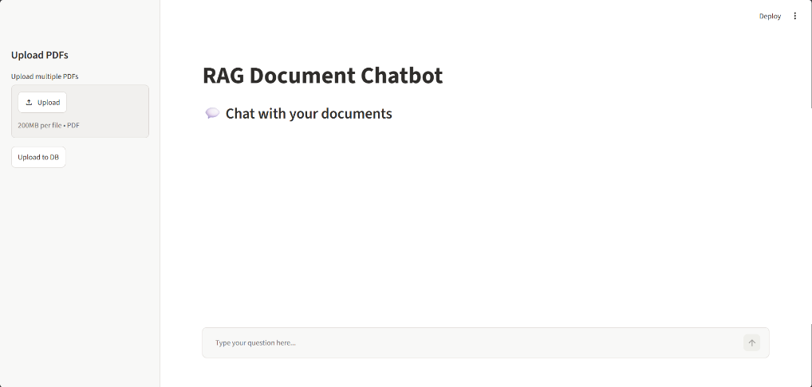

# 🧠 RAG-Powered Document Assistant



A modular **Retrieval-Augmented Generation (RAG)** web application that lets users upload PDF documents and ask questions answered strictly from the uploaded content. It uses a decoupled microservice architecture with a **FastAPI** backend, a **Streamlit** frontend, **Pinecone** as the vector store, **Google Gemini** for embeddings, and **Groq** (`openai/gpt-oss-120b`) for answer generation.

---

## ✨ Features

- 📄 **Multi-PDF Upload & Parsing**: Upload one or more PDF files from the Streamlit sidebar and parse them with `PyPDFLoader`.
- ✂️ **Chunking & Embeddings**: Splits documents into overlapping chunks (`chunk_size=500`, `chunk_overlap=50`) and embeds them with Google Generative AI (`models/gemini-embedding-001`, 768 dimensions).
- 🌲 **Pinecone Vector Store**: Automatically provisions (if missing) and upserts document vectors to a serverless Pinecone index (`aws` / `us-east-1`, `dotproduct` metric).
- 🤖 **Context-Grounded Q&A**: Uses `ChatGroq` (`openai/gpt-oss-120b`) with LangChain `RetrievalQA` (`top_k=3`) and a dedicated assistant prompt (`MediBot`) that answers strictly from retrieved document context and cites sources.
- 💬 **Interactive Chat & Export**: Persistent session chat UI with source attribution and one-click `.txt` chat history download.

---

## 📂 Project Structure

```text
rag-chatbot/
├── assets/
│   └── app-preview.png
├── client/                         # Streamlit Frontend
│   ├── components/
│   │   ├── chatUI.py               # Chat interface & source display
│   │   ├── history_download.py     # Export chat history as .txt
│   │   └── upload.py               # Sidebar PDF uploader
│   ├── utils/
│   │   └── api.py                  # HTTP client wrappers for FastAPI
│   ├── app.py                      # Streamlit entry point
│   ├── config.py                   # Backend API_URL setting
│   └── requirements.txt
├── server/                         # FastAPI Backend
│   ├── modules/
│   │   ├── llm.py                  # ChatGroq & RetrievalQA chain setup
│   │   ├── load_vectorstore.py     # PDF parsing, Gemini embeddings & Pinecone upsert
│   │   ├── pdf_handlers.py         # PDF file saving helper
│   │   └── query_handlers.py       # Query execution & response formatting
│   ├── uploaded_pdfs/              # Stored uploaded PDFs (runtime)
│   ├── logger.py                   # Console logger setup
│   ├── main.py                     # FastAPI app & route handlers
│   ├── requirements.txt
│   └── .env                        # Local environment variables (not committed)
└── README.md
```

---

## 🔄 How It Works

1. **Ingest (`POST /upload_pdfs/`)**: Uploaded PDFs are saved to `server/uploaded_pdfs/`, loaded page-by-page with `PyPDFLoader`, and split into 500-character chunks with 50-character overlap.
2. **Embed & Store**: Each chunk is embedded using `GoogleGenerativeAIEmbeddings` (`models/gemini-embedding-001`, 768 dimensions) and upserted into Pinecone with text and source metadata.
3. **Retrieve & Answer (`POST /ask/`)**: User questions are embedded with the same Gemini model, matched against Pinecone (`top_k=3`), and passed into LangChain's `RetrievalQA` chain powered by `ChatGroq` (`openai/gpt-oss-120b`) to return a grounded answer and source references.

---

## 🚀 Getting Started Locally

### Prerequisites

- Python 3.11+
- API keys for [Groq](https://console.groq.com/), [Google AI Studio (Gemini)](https://aistudio.google.com/), and [Pinecone](https://www.pinecone.io/)

### 1. Clone the Repository

```bash
git clone https://github.com/firasahmeddaniyal/rag-chatbot.git
cd rag-chatbot
```

### 2. Setup & Run the Backend (FastAPI)

Run the backend from inside the `server/` directory so it locates `.env`, `modules/`, and `uploaded_pdfs/`:

```bash
cd server
python -m venv venv

# Activate the virtual environment
# Windows:
venv\Scripts\activate
# macOS / Linux:
source venv/bin/activate

pip install -r requirements.txt
```

Create a `server/.env` file with your credentials:

```env
GROQ_API_KEY="your_groq_api_key"
GOOGLE_API_KEY="your_google_api_key"
PINECONE_API_KEY="your_pinecone_api_key"
PINECONE_INDEX_NAME="medical-index"
```

Start the FastAPI server:

```bash
uvicorn main:app --reload
```

The API will be available at `http://127.0.0.1:8000` (interactive docs at `http://127.0.0.1:8000/docs`).

### 3. Setup & Run the Frontend (Streamlit)

In a new terminal, start the Streamlit client from the `client/` directory:

```bash
cd client
pip install -r requirements.txt
streamlit run app.py
```

By default, `client/config.py` connects to `http://127.0.0.1:8000`. Open `http://localhost:8501` in your browser to use the app.

---

## 🌐 API Endpoints (FastAPI)

| Method | Endpoint | Description |
| :--- | :--- | :--- |
| `GET` | `/test` | Health check endpoint returning a status message |
| `POST` | `/upload_pdfs/` | Upload one or more PDF files (`files`) and upsert embeddings to Pinecone |
| `POST` | `/ask/` | Submit a `question` form field and receive `{ "response": ..., "sources": [...] }` |

---

## 🛠️ Tech Stack

- **[FastAPI](https://fastapi.tiangolo.com/)** — Backend REST API
- **[Streamlit](https://streamlit.io/)** — Interactive chat & upload UI
- **[LangChain](https://www.langchain.com/)** — Document loading, chunking, and `RetrievalQA` orchestration
- **[Pinecone](https://www.pinecone.io/)** — Serverless vector database
- **[Google Gemini Embeddings](https://ai.google.dev/)** — `models/gemini-embedding-001` (768-dim)
- **[Groq](https://groq.com/)** — `openai/gpt-oss-120b` LLM inference
